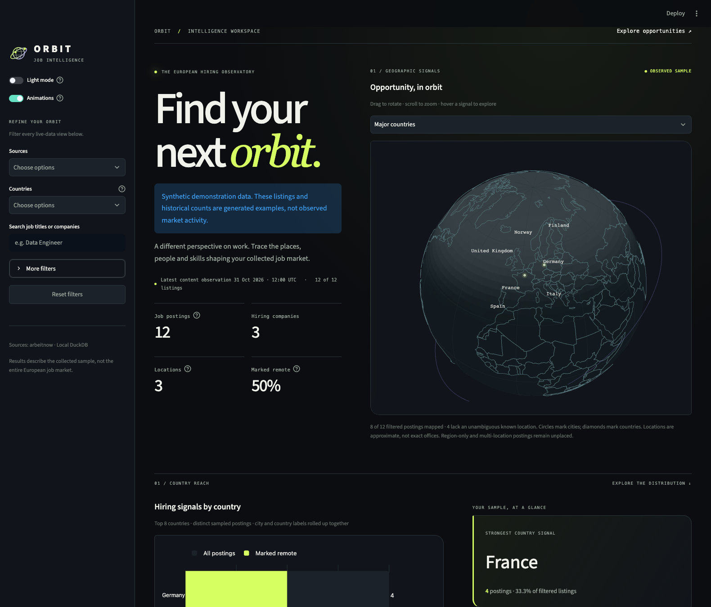
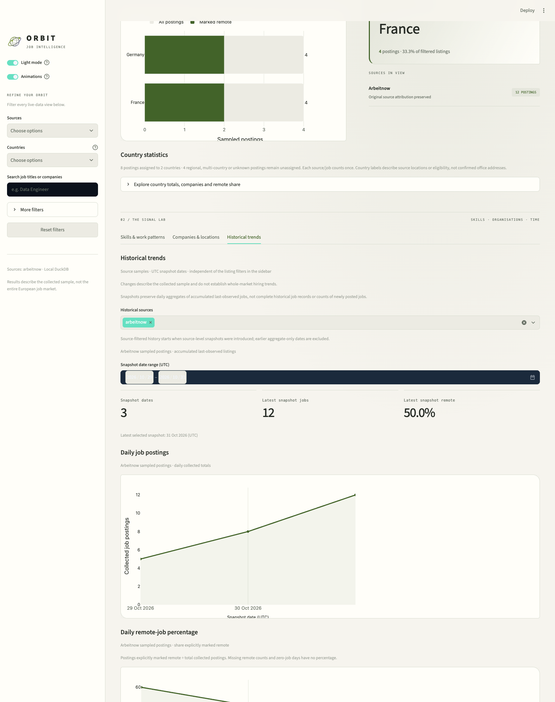
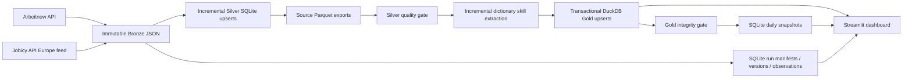

# Orbit · European Job Market Pipeline

[](https://github.com/benny-shibin/european-job-market-pipeline/actions/workflows/tests.yml)

A local analytics pipeline that collects Arbeitnow and Jobicy listings, tracks content changes, transforms only changed jobs, and serves a Streamlit dashboard with daily history. Built with Python 3.12, SQLite, Polars, DuckDB, Plotly and Streamlit. No API credentials or paid infrastructure are required.

**Results describe collected source samples, not the European job market as a whole.** Jobs are accumulated last-observed records, not a verified list of open vacancies. Daily snapshots preserve aggregates; full version history lives separately in SQLite. Jobicy contributes remote listings eligible for Europe from its rolling publication window.



[Light-mode preview](docs/images/dashboard-light.png) · [Updated chart details](docs/images/dashboard-analysis.png)



## Quick start

Run from the repository root:

```sh
python3.12 -m venv .venv
source .venv/bin/activate
python -m pip install -r requirements.txt
python -m src.job_market.cli run --sources arbeitnow jobicy
streamlit run dashboard/app.py
```

Open http://localhost:8501. Use **Light mode** in the sidebar to switch the interface and charts. Animations are enabled by default; decorative motion respects browser reduced-motion settings. Advanced criteria live under **More filters**; selections are preserved when switching themes. Stop the dashboard before warehouse updates if DuckDB reports a lock. `python -m src.job_market.cli run` defaults to Arbeitnow only. `--max-pages 5` adjusts the fetch cap. Jobicy permits new automated synchronization passes at most hourly; daily execution is recommended. Use `python -m src.job_market.cli resume` to process saved data without another API call.

The **Source connections & ingestion health** panel audits the saved Arbeitnow and Jobicy data. LinkedIn and StepStone are labelled **Access required**: the reviewed official APIs do not provide a suitable free public jobs-search feed. See [source access findings](docs/sources.md).

For a network-free demo, generate synthetic data in a **new directory outside the checkout**:

```sh
python -m scripts.create_demo --output /tmp/job-market-demo
JOB_MARKET_DATA_DIR=/tmp/job-market-demo/data streamlit run dashboard/app.py
```

The dashboard displays a synthetic-data banner. Demo generation refuses an existing output directory and never overwrites real data. Screenshots above use this demo; they are not market findings.

## Features

- An interactive offline 3D globe zoomed toward Europe, with country labels, approximate city/country signals, mapped-location coverage, and hoverable posting counts.
- Country filters, posting rankings, company totals and remote-share statistics, with multi-country/unknown scopes reported separately.
- A custom observatory layout with oversized typography, a globe beside the headline, charcoal/lime and warm light themes, compact metrics, country comparisons, lollipop rankings, work-arrangement mosaics, and source skill heatmaps.
- Default animations with staggered reveals, an orbital sweep and chart transitions; decorative motion respects the browser’s reduced-motion preference.
- Source, title/company, normalized location, company, skill and remote-status filters; equivalent city/country names share one entry, with original labels preserved in listings and CSV exports.
- Skill rankings, company/location summaries and reported work arrangement charts.
- UTC daily posting totals, remote share and multi-skill historical charts with source/date/skill selection; explicit single-day and empty states.
- Durable ingestion manifests, changed job IDs and versions, page replay and incremental Silver/skill/Gold updates.
- First/last seen, full content versions and conservative observed/not-observed lifecycle tracking.
- Critical quality gates with machine-readable reports; atomic Gold updates and market/skill snapshot transactions.
- Local run logs, exclusive writer lock, daily macOS scheduling and persistent Docker Compose deployment.

## Architecture



Source/job identity is stable across layers. Content fingerprints exclude only specified volatile fields. Dimension keys remain stable across updates. Parquet exports are refreshed only for changed sources; Gold still scans Silver projections to find affected records. This saves transformation and write work, not all input I/O. A no-change run does not rewrite unchanged job records or Parquet exports.

## Commands

| Task | Command |
| --- | --- |
| Full daily run | `python -m src.job_market.cli run --sources arbeitnow jobicy` |
| Offline retry/recovery | `python -m src.job_market.cli resume` |
| Dashboard | `streamlit run dashboard/app.py` |
| All tests | `python -m pytest -q` |
| Install daily 09:00 Mac schedule | `python scripts/manage_schedule.py install --hour 9` |
| Inspect scheduler | `python scripts/manage_schedule.py status` |
| Build/populate Docker storage | `docker compose run --build --rm pipeline` |
| Start container dashboard | `docker compose up --build -d dashboard` |
| Test in Docker | `docker compose run --build --rm tests` |

The launchd calendar uses the Mac system timezone and requires a logged-in user and available Mac. Missed days cannot be reconstructed just by rerunning today. Container data lives in a persistent named volume, separate from host data. `docker compose down` preserves it; `down -v` deletes it.

## Data and SQL

| Location | Purpose |
| --- | --- |
| `data/bronze/<source>/date=*/run=*/` | Original API pages and per-run JSON manifest |
| `data/state/jobs.sqlite` | Fetch scope, page checkpoints, job state/history and changed IDs |
| `data/silver/processing.sqlite` | Persistent composite-key job upsert store and export checkpoints |
| `data/silver/<source>/` | Jobs/staging/skill Parquet exports and skill fingerprints |
| `data/gold/job_market.duckdb` | Stable dimensions, affected-row facts/bridges, analytical views |
| `data/state/snapshots.sqlite` | Aggregate daily market/skill and source-level snapshots |
| `data/state/runs/`, `data/state/quality/` | Stage logs, counters and critical/advisory quality reports |
| `sql/models.sql` | Reusable Gold views, installed by the Gold builder |
| `sql/skill_trends.sql` | SQLite historical skill query; run against snapshots.sqlite |

Example: `SELECT * FROM skill_demand ORDER BY job_count DESC;` or `SELECT * FROM skill_cooccurrence ORDER BY job_count DESC;` in DuckDB. `remote_skill_summary`, `geography_summary`, `company_summary`, `posting_date_summary`, and `duplicate_candidates` preserve source provenance. Duplicate candidates are not automatically merged. [Definitions and denominators](docs/analytics.md).

## Testing and documentation

```sh
python -m pip install -r requirements-dev.txt
python -m pytest -q
```

Tests use isolated temporary storage and mocked HTTP, exercise real transformations and Streamlit controls, and cover no-op runs, changed records, crash/restart, scoped disappearance, rollback, multiple sources, quality failures and historical empty states. CI runs the suite and container tests. [Testing details](docs/testing.md).

- [Schemas, dictionary and timestamp semantics](docs/data-model.md)
- [Incremental design, migration and recovery](docs/incremental-processing.md)
- [Source coverage, fair use and attribution](docs/sources.md)
- [Operations, diagnostics, scheduling and Docker](docs/operations.md)
- [Analytics definitions](docs/analytics.md)
- [Globe data provenance and location precision](dashboard/assets/NOTICE.md)

SQLite provides durable local transactions for operational state; DuckDB serves analytical joins over columnar exports. These files are suited to a single-machine project, not concurrent distributed writers. The OS lock protects cooperating CLI writers. Separate Gold and snapshot databases cannot commit atomically together; resume reconciles a failure between stages. No automatic data retention, geocoding, semantic skill extraction, or paid always-on hosting is included. Source API availability, descriptions and schemas may change.
