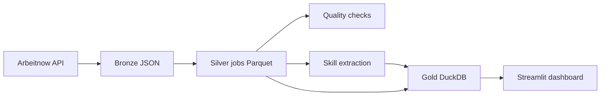

# European Job Market Pipeline

A local Python pipeline that collects Arbeitnow job listings, cleans and deduplicates them with Polars, detects technology skills, and builds a DuckDB warehouse for an interactive Streamlit dashboard.

The dashboard reports the **collected sample**, not the entire European job market. No credentials are required for ingestion. Data files stay local and are excluded from Git.

## Quick start

Use Python 3.12. Run all commands from the repository root; pipeline paths are relative to the working directory.

```bash
python3.12 -m venv .venv
source .venv/bin/activate
python -m pip install -r requirements.txt

python -m src.job_market.ingestion.arbeitnow
python -m src.job_market.transformations.bronze_2_silver
python -m src.job_market.quality.validators
python -m src.job_market.transformations.extract_skills
python -m src.job_market.transformations.silver_2_gold

streamlit run dashboard/app.py
```

Open the local URL printed by Streamlit, normally `http://localhost:8501`. Keep ingestion and warehouse rebuilds separate from dashboard reads to avoid database locks.

## What you can explore

- Filter titles/companies, locations, companies, skills (match any), and reported remote status.
- Compare skill mentions, hiring companies, and source-reported locations.
- See remote proportions, hover for chart details, and sort job listings.
- Follow original posting links and export the filtered listing table as CSV.
- Reset all filters with one button. Animations respect reduced-motion preferences.

The dark theme lives in `.streamlit/config.toml`; interface styles live in `dashboard/styles.css`. Restart Streamlit after changing theme configuration. If a saved browser theme overrides the default, select Dark in Streamlit settings.

## Pipeline



Validation is a separate command: run it before skills and Gold. Transformations do not invoke it automatically.

| Location | Purpose |
| --- | --- |
| `src/job_market/ingestion/arbeitnow.py` | Paginated HTTP collection |
| `src/job_market/ingestion/incremental.py` | Optional SQLite-backed change classification |
| `src/job_market/transformations/` | Silver, skill bridge, and Gold builders |
| `src/job_market/quality/validators.py` | Silver quality gate |
| `config/skills.yaml` | Canonical skill names and keyword aliases |
| `sql/analytics.sql` | Example warehouse queries |
| `dashboard/` | Streamlit application and styles |
| `tests/test_e2e.py` | Offline pipeline and dashboard integration tests |

## Testing

```bash
python -m pip install -r requirements-dev.txt
python -m pytest -q
```

Tests run against temporary files with mocked HTTP responses. They execute the real transformation commands, validate warehouse results, and interact with the dashboard through Streamlit AppTest. No live API access or existing local database is required. GitHub Actions runs this suite on pushes and pull requests.

See [testing](docs/testing.md), [data model](docs/data-model.md), and [operations](docs/operations.md) for details and current limitations.
